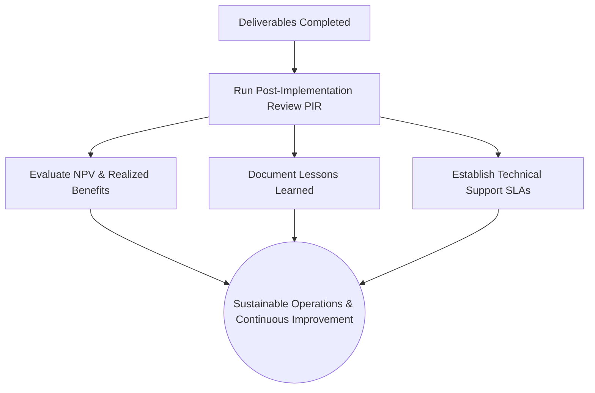

# 📘 SOFTWARE PROJECT MANAGEMENT INDIVIDUAL ASSIGNMENT REPORT
## PROJECT: ENTERPRISE-GRADE SCHOOL MANAGEMENT SYSTEM (SMS)

---

### **DOCUMENT METADATA**
* **Project Name:** School Management System (SMS)
* **Author:** Project Management Consultant / Lead Developer (Individual Assignment)
* **Standard:** Academic Grade (A4, Calibri 11 Style, Spaced Layout Equivalent)
* **Tech Stack:** React 18, Vite 5, TypeScript 5, Node.js, Express 5, MySQL (XAMPP), TailwindCSS 3
* **Target Audience:** School Administration, Project Sponsors, and Academic Examiners

---

## 📑 TABLE OF CONTENTS
1. [Section 1: Project Lifecycle Flow & Task Sequence Diagram](#section-1-project-lifecycle-flow--task-sequence-diagram)
2. [Section 2: Role and Governance of the Project Manager](#section-2-role-and-governance-of-the-project-manager)
3. [Section 3: Business Case, Financial Appraisals, and Stakeholder Governance](#section-3-business-case-financial-appraisals-and-stakeholder-governance)
4. [Section 4: Balancing Project Constraints (Scope, Time, Cost, and Quality)](#section-4-balancing-project-constraints-scope-time-cost-and-quality)
5. [Section 5: Resource Mobilization, Engagement, and Monitoring](#section-5-resource-mobilization-engagement-and-monitoring)
6. [Section 6: Risk Governance and Contingency Analysis](#section-6-risk-governance-and-contingency-analysis)
7. [Section 7: Project Closure, Success Criteria, and Post-Project Activities](#section-7-project-closure-success-criteria-and-post-project-activities)

---

## SECTION 1: PROJECT LIFECYCLE FLOW & TASK SEQUENCE DIAGRAM

A successful software development life cycle (SDLC) requires a highly structured, logical, and sequential progression of events. For the School Management System (SMS), a hybrid project management methodology was adopted—combining the predictive planning of Waterfall with the iterative execution of Agile (Scrum). 

The flow diagram below spans the four critical project management phases: **Starting**, **Planning**, **Execution & Monitoring**, and **Closure**.

### **1.1 Logical Project Lifecycle Flow Diagram**

```mermaid
graph TD
    %% Define Phases Styles
    classDef startPhase fill:#e1f5fe,stroke:#03a9f4,stroke-width:2px,color:#01579b;
    classDef planPhase fill:#ede7f6,stroke:#673ab7,stroke-width:2px,color:#311b92;
    classDef execPhase fill:#e8f5e9,stroke:#4caf50,stroke-width:2px,color:#1b5e20;
    classDef closePhase fill:#fffde7,stroke:#fbc02d,stroke-width:2px,color:#f57f17;

    %% Starting Phase
    subgraph "Phase 1: Starting (Initiation)"
        A[Project Charter & Mandate] -->|Tool: Google Docs / MS Word| B[Stakeholder Identification]
        B -->|Technique: Power-Interest Matrix| C[Feasibility & Business Case Approval]
        C -->|Technique: NPV / ROI / Payback Appraisals| D[Project Kickoff Meeting]
    end
    class A,B,C,D startPhase;

    %% Planning Phase
    subgraph "Phase 2: Planning"
        D -->|Tool: JIRA / Trello| E[Detailed Requirements Gathering]
        E -->|Technique: MoSCoW Prioritization| F[WBS & Scope Definition]
        F -->|Tool: MS Project / Gantt| G[Schedule & Critical Path CPM Development]
        G -->|Technique: Bottom-Up & Analogous Estimations| H[Budget Allocation & Baseline]
        H -->|Tool: Git / GitHub Repository| I[Architecture & DB Schema Design]
    end
    class E,F,G,H,I planPhase;

    %% Execution & Monitoring Phase
    subgraph "Phase 3: Execution & Monitoring"
        I -->|Tech: React, TypeScript, TailwindCSS| J[Frontend Portal Development]
        I -->|Tech: Node.js, Express, MySQL| K[Backend API Development]
        J & K -->|Tool: Axios Integration| L[System Integration & DB Connectivity]
        L -->|Tool: Git / GitHub Pull Requests| M[Code Reviews & Static Analysis]
        M -->|Tool: Jest / Postman / system_verification.js| N[System Verification & Quality Control]
        N -->|Technique: Earned Value Management EVM| O{Milestone Review & QA Approval}
        O -- Retest / Defect Found --> J
    end
    class J,K,L,M,N,O execPhase;

    %% Closure Phase
    subgraph "Phase 4: Project Closure"
        O -- Approved --> P[User Acceptance Testing UAT]
        P -->|Technique: Training & Admin Handover| Q[Production Deployment & Go-Live]
        Q -->|Tool: XAMPP MySQL Production Backup| R[Lessons Learned Workshop]
        R -->|Technique: Administrative & Financial Closure| S((Project Closed & Archived))
    end
    class P,Q,R,S closePhase;
```



### **1.2 Description of Stages, Tools, and Techniques**

The sequential process moves systematically through these core project milestones:
1. **Starting Phase:** Focused on obtaining formal authorization and aligning stakeholders. The **Project Charter** acts as the key input, with **Net Present Value (NPV)** calculations validating the initial financial feasibility.
2. **Planning Phase:** Establishing the project boundaries. A **Work Breakdown Structure (WBS)** is developed to decompose the project into manageable work packages, and the **Critical Path Method (CPM)** is used to model task dependencies and define high-level milestones.
3. **Execution & Monitoring Phase:** The core engineering stage where **React**, **TypeScript**, **Node.js**, **Express**, and **MySQL** are utilized to build the 5 user portals (Admin, Principal, Teacher, Student, and Parent). Integration is achieved via **Axios** APIs, while quality is continuously monitored through automated verification scripts (`tests/system_verification.js`), code reviews, and static linting.
4. **Closure Phase:** Involves transition, evaluation, and archiving. High-level user training is conducted, the database SQL backups are securely archived using **phpMyAdmin**, and a **Post-Implementation Review (PIR)** is compiled to evaluate success criteria.

---

## SECTION 2: ROLE AND GOVERNANCE OF THE PROJECT MANAGER

The success of a highly integrated software product like the School Management System (SMS) depends heavily on the organizational environment and the governance role played by the Project Manager (PM). 

### **2.1 Proposed Organizational Structure: Balanced Matrix**

To manage the SMS project effectively, a **Balanced Matrix Organizational Structure** is recommended. In a Balanced Matrix, resources (such as developers, UI/UX designers, and database administrators) are drawn from their respective functional departments but are assigned to work on the project under the clear authority of the Project Manager.

```
                           +------------------------+
                           |    Executive Sponsor   |
                           |   (School Board / IT)  |
                           +-----------+------------+
                                       |
                         +-------------+-------------+
                         |  Project Management Office |
                         |           (PMO)           |
                         +-------------+-------------+
                                       |
                     +-----------------+-----------------+
                     |                                   |
           +---------v----------+              +---------v----------+
           | Functional Head    |              |  Project Manager   |
           | (Engineering / QA) |              |  (Authority Over   |
           +---------+----------+              |  Project Delivery) |
                     |                         +---------+----------+
         +-----------+-----------+                       |
         |           |           |                       |
   +-----v-----+ +---v---+ +-----v-----+                 |
   | Developer | |  QA   | | Database  |                 |
   |  (Staff)  | | Staff | |   Admin   |                 |
   +-----+-----+ +---+---+ +-----+-----+                 |
         |           |           |                       |
         +-----------+-----------+                       |
                     |                                   |
                     +-----------------------------------+
                     | (Assigned to SMS Project Team)
```

#### **Justification for a Balanced Matrix Structure:**
1. **Efficient Resource Utilization:** Since developers and designers are shared with functional pools, they do not remain idle when their specific deliverables are finished. For instance, the Database Administrator (DBA) designs the normalized MySQL database schema in the early stages, then transitions to occasional performance tuning while developers focus on React UI portals.
2. **Dedicated Project Focus:** Unlike a weak matrix or a purely functional structure where the PM acts merely as an expeditor with no real authority, the PM in a Balanced Matrix holds the authority to define schedules, control the budget, and direct the day-to-day tasks of the project team.
3. **Enhanced Cross-Functional Collaboration:** The SMS project requires deep collaboration between frontend web development, backend API endpoints, and database management. The matrix structure bridges these disciplines under one cohesive management layer.

### **2.2 Responsibilities, Authority Levels, and Goals of the PM**

| Dimension | Details & Description |
| :--- | :--- |
| **Responsibilities** | <ul><li>**Scope Definition & Management:** Creating and managing the WBS, preventing scope creep from stakeholders.</li><li>**Schedule Management:** Developing the project schedule and monitoring the Critical Path using Gantt charts.</li><li>**Resource Management:** Allocating tasks to developers, ensuring balanced workloads, and resolving resource conflicts.</li><li>**Stakeholder Communication:** Managing expectations of the school board, principal, parents, and teachers.</li></ul> |
| **Authority Levels** | <ul><li>**Decision Making:** Medium-to-High. The PM has authority over schedule changes, task assignments, and internal technical trade-offs.</li><li>**Financial Control:** Medium. The PM manages the allocated budget baseline of $35,000, approving ordinary expenditures, but must consult the Executive Sponsor for variances exceeding ±5%.</li><li>**Staffing Authority:** Shared. The PM can request specific technical resources from functional managers but does not have direct hiring/firing authority.</li></ul> |
| **Project Goals** | <ul><li>**On-Time Delivery:** Launching the software within the designated 14-week window to align with the new academic term.</li><li>**On-Budget Delivery:** Completing development within the $35,000 budget.</li><li>**Quality & Compliance:** Meeting strict usability, performance (response time < 200ms), and role-based data security criteria.</li></ul> |

### **2.3 Is the PM Responsible for "Doing" the Project?**

**No, the Project Manager is not responsible for "doing" the project.** 

In project management theory, a clear distinction must be made between **managing the project** and **executing the technical deliverables**:
* **The Role of the PM:** The PM's primary role is governance, facilitation, coordination, and control. The PM acts as an enabler—managing the variables of Scope, Time, Cost, and Quality, removing roadblocks, securing resources, and managing risks. The PM defines *what* needs to be done, *when* it must be completed, and *how* progress is tracked.
* **The Role of the Technical Team:** The developers, designers, and database administrators are responsible for the physical execution ("doing") of the project. They write the React frontend code, implement Express API controllers, write test cases, and deploy MySQL databases.
* **Analogy:** The PM is like the conductor of an orchestra. The conductor does not play the violin, flute, or drums themselves, but is entirely responsible for ensuring that all musicians play in harmony, stay on tempo, and deliver a flawless collective performance. If a PM starts "doing" the technical work (e.g., writing backend route handlers), they lose the objective high-level view required to manage critical risks, leading to planning failures and overall project delay.

---

## SECTION 3: BUSINESS CASE, FINANCIAL APPRAISALS, AND STAKEHOLDER GOVERNANCE

A robust business case justifies the initial investment, demonstrating that the benefits of the proposed School Management System outweigh the developmental and operational costs.

### **3.1 Investment Appraisal Methods**

To evaluate the financial feasibility of the SMS project, three primary appraisal techniques were used over a **5-year horizon**:
1. **Net Present Value (NPV):** Evaluates the time value of money by discounting future net cash inflows back to their present value.
2. **Return on Investment (ROI):** Measures the absolute efficiency of the investment.
3. **Payback Period:** Identifies the time required for the cash inflows to recover the initial development investment.

#### **Financial Assumptions:**
* **Initial Development Investment (Year 0):** $35,000 (covers developer salaries, software licensing, database setup).
* **Annual Operational Cost Savings:** $15,000 (replacing physical registers, paper, manual report card production, and streamlined operations).
* **Annual System Maintenance Cost (Years 1–5):** $3,000 (cloud hosting, database backup, occasional technical support).
* **Net Annual Cash Inflow:** $15,000 - $3,000 = **$12,000 per year**.
* **Discount Rate (Cost of Capital):** 8% per annum.

#### **NPV, Payback, and ROI Calculation Table:**

| Year | Cash Inflow ($) | Cash Outflow ($) | Net Cash Flow ($) | Discount Factor (1+r)^-t | Present Value (PV) ($) | Cumulative Net Cash ($) |
| :---: | :---: | :---: | :---: | :---: | :---: | :---: |
| **Year 0** | - | $35,000 | -$35,000 | 1.0000 | -$35,000.00 | -$35,000.00 |
| **Year 1** | $15,000 | $3,000 | $12,000 | 0.9259 | $11,110.80 | -$23,000.00 |
| **Year 2** | $15,000 | $3,000 | $12,000 | 0.8573 | $10,287.60 | -$11,000.00 |
| **Year 3** | $15,000 | $3,000 | $12,000 | 0.7938 | $9,525.60 | $1,000.00 |
| **Year 4** | $15,000 | $3,000 | $12,000 | 0.7350 | $8,820.00 | $13,000.00 |
| **Year 5** | $15,000 | $3,000 | $12,000 | 0.6806 | $8,167.20 | $25,000.00 |
| **Total** | **$75,000** | **$50,000** | **$25,000** | - | **NPV = $12,911.20** | - |

#### **Appraisal Output Summary:**
* **Net Present Value (NPV):** 
  $$\text{NPV} = \sum (\text{Present Value of Years 1 to 5}) - \text{Initial Investment}$$
  $$\text{NPV} = \$47,911.20 - \$35,000.00 = \mathbf{\$12,911.20}$$
  *Decision Rule:* Since the NPV is **positive ($12,911.20 > 0)**, the project is financially viable and will generate net positive value for the school.
* **Return on Investment (ROI):**
  $$\text{ROI} = \frac{\text{Total Net Benefits} - \text{Total Development Investment}}{\text{Total Development Investment}} \times 100$$
  $$\text{ROI} = \frac{(\$12,000 \times 5) - \$35,000}{\$35,000} \times 100 = \frac{\$25,000}{\$35,000} \times 100 = \mathbf{71.43\%}$$
  *Decision Rule:* An ROI of 71.43% over 5 years indicates an excellent rate of return on capital.
* **Payback Period:**
  The cumulative cash flow turns positive in Year 3.
  $$\text{Payback Period} = 2 \text{ Years} + \left( \frac{\text{Remaining Investment at end of Year 2}}{\text{Net Cash Flow in Year 3}} \right) \text{ Years}$$
  $$\text{Payback Period} = 2 + \left( \frac{\$11,000}{\$12,000} \right) = \mathbf{2.92\text{ Years}} \approx \text{2 Years and 11 Months}$$
  *Decision Rule:* The school recovers its entire initial capital outlay in under 3 years, which fits within the standard threshold of 3 years for educational IT infrastructure projects.

---

### **3.2 Comparative Analysis: Evaluating Internal vs. External (Outsourced) Projects**

A major project management decision is whether to build the software using an in-house development team (internal) or contract an external software agency (outsourced).

**Can the exact same factors be used to evaluate both internal and external projects?**

**No, the same appraisal factors cannot be applied uniformly without modification.** While high-level metrics like NPV or ROI remain core financial baselines, the underlying evaluation parameters, risk weightings, and qualitative factors differ significantly:

| Evaluation Factor | Internal Project (In-House Build) | External/Outsourced Project (Vendor Contract) |
| :--- | :--- | :--- |
| **Capital vs. Operational Expense** | Costs are primarily operational salary allocations (OpEx). Low initial cash layout but higher long-term staff maintenance. | Costs are heavily capital expenses (CapEx) based on binding commercial contract milestones. High initial cash outflow. |
| **Risk Allocation** | **All risks are retained internally.** If developers quit, the school faces project delay. If the database crashes, the internal IT team must troubleshoot. | **Risks are shifted to the vendor via Service Level Agreements (SLAs)** and legal penalty clauses for late delivery or performance failure. |
| **Evaluation Criteria** | Evaluated on developer utilization rates, code quality standards, capability building, and organizational knowledge retention. | Evaluated on vendor credentials, technical support SLAs, contractual terms, payment milestones, and legal liabilities. |
| **Control & Flexibility** | Complete control over codebase. Changes to scope can be made fluidly by the PM. | Low control over intermediate code. Changes to scope require formal "Change Orders" that incur significant extra costs. |

---

### **3.3 Stakeholder Management Matrix**

To ensure smooth project delivery, a stakeholder analysis was conducted to map out their power, interest, and corresponding management strategy.

```
       High +-----------------------------------+-----------------------------------+
            |                                   |                                   |
            |           KEEP SATISFIED          |           MANAGE CLOSELY          |
            |                                   |                                   |
            |   • School Principal              |   • School Board (Sponsor)        |
            |   • Database Administrator        |   • Lead System Developers        |
            |                                   |                                   |
  POWER     +-----------------------------------+-----------------------------------+
            |                                   |                                   |
            |              MONITOR              |            KEEP INFORMED          |
            |         (MINIMUM EFFORT)          |                                   |
            |                                   |   • School Teachers               |
            |   • Parents                       |   • Students                      |
            |                                   |                                   |
        Low +-----------------------------------+-----------------------------------+
            Low                                                                    High
                                     INTEREST
```

| Stakeholder | Potential Impact | Management Strategy |
| :--- | :--- | :--- |
| **School Board (Sponsor)** | **High Power / High Interest.** Controls project funding. Can cancel or redirect the project. | **Manage Closely.** Provide monthly status reports, financial reports with NPV updates, and demonstrate key milestones. |
| **School Principal** | **High Power / Medium Interest.** Evaluates systemic academic benefits. Has authority over final approval of portals (UAT). | **Keep Satisfied.** Involve in designing administrative workflows (such as announcement approval gates and report reviews). |
| **Lead Developer / Team** | **High Power / High Interest.** High technical influence. Key resources for successful implementation. | **Manage Closely / Empower.** Conduct daily sprint meetings, maintain a clear task checklist (`task.md`), and run code reviews. |
| **Teachers** | **Low Power / High Interest.** Primary users who input grades and manage class schedules. Can resist system adoption if too complex. | **Keep Informed / Engage.** Conduct interactive training sessions, provide step-by-step user guides, and address feedback. |
| **Students & Parents** | **Low Power / Medium Interest.** End-users who submit assignments and view report cards. High volume of system usage. | **Monitor & Support.** Establish clear channels for bug reporting, and implement user-friendly React toast notifications. |

---

## SECTION 4: BALANCING PROJECT CONSTRAINTS (SCOPE, TIME, COST, AND QUALITY)

Managing a project effectively requires keeping the four core constraints of the **Project Management Triangle** in continuous balance. Altering one constraint inevitably impacts the others.

```
                                    Scope
                                      /\
                                     /  \
                                    /    \
                                   /  Q   \
                                  /________\
                                 Cost      Time
                           
                       [Q: Quality is at the center]
```

---

### **4.1 Work Breakdown Structure (WBS)**

The project scope was decomposed systematically down to Level 3 Work Packages:

```
1.0 School Management System (SMS) Project
 ├── 1.1 Project Initiation & Starting
 │    ├── 1.1.1 Develop Project Charter
 │    └── 1.1.2 Run Business Appraisals (NPV/ROI)
 ├── 1.2 Requirements Analysis & System Scope
 │    ├── 1.2.1 Document Detailed System Requirements
 │    └── 1.2.2 Formulate Scope Baseline & WBS Dictionary
 ├── 1.3 Architecture & Database Design
 │    ├── 1.3.1 Design Normalized ER Model (MySQL)
 │    └── 1.3.2 Design Frontend Component Architecture
 ├── 1.4 Back-End API Development
 │    ├── 1.4.1 Implement JWT Authentication Middleware
 │    ├── 1.4.2 Develop Academic Records & Grade Management Controllers
 │    └── 1.4.3 Develop Announcement Approval Workflow Route Handlers
 ├── 1.5 Front-End Portal Integration
 │    ├── 1.5.1 Build Admin Portal (Inventory & Users)
 │    ├── 1.5.2 Build Principal & Teacher Portals (Marks Submission)
 │    └── 1.5.3 Build Student & Parent Dashboards (Assignments)
 ├── 1.6 Verification & Testing
 │    ├── 1.6.1 Run Automated Verification (tests/system_verification.js)
 │    └── 1.6.2 Conduct User Acceptance Testing (UAT)
 └── 1.7 Deployment & Handover
      ├── 1.7.1 Configure Production Server & Perform Database Backup
      └── 1.7.2 Deliver Maintenance Guide & Close Project
```

**Scope Definition Techniques Used:**
* **MoSCoW Method:** Classified requirements as *Must-Have* (Role-based authentication, Marks entry, DB backup), *Should-Have* (Assignment file uploads via Multer, email notices), *Could-Have* (Automated PDF generation), and *Won't-Have* (Real-time chat in Phase 1).
* **Decomposition:** Systematically broke down higher-level deliverables into small, manageable units of work that could be assigned to a single developer and accurately estimated.

---

### **4.2 Schedule & Critical Path Method (CPM)**

Developing a realistic project schedule requires identifying the sequence of activities that dictates the shortest possible project duration—known as the **Critical Path**.

#### **Activity Precedence Table:**

| Activity ID | Task Description | Predecessor | Duration (Weeks) |
| :---: | :--- | :---: | :---: |
| **A** | Requirements Sign-off & Charter Approval | None | 2 |
| **B** | Database Schema & System Architecture Design | A | 2 |
| **C** | Backend API & Database Implementation (MySQL) | B | 3 |
| **D** | Frontend UI & Portal Layout Design | B | 2 |
| **E** | Frontend & Backend Axios API Integration | C, D | 2 |
| **F** | Comprehensive Testing & System Verification | E | 2 |
| **G** | User Acceptance Testing (UAT) & Administrative Handover | F | 1 |
| **H** | Production Server Deployment & Database Backups | G | 2 |

#### **Critical Path Network Diagram:**

```
                  +---------------+           +---------------+
                  |  Activity D   |           |  Activity E   |
               +->|  (Frontend)   |---------->| (Integration) |-+
               |  |  Duration: 2  |           |  Duration: 2  | |
               |  |  ES:4 / EF:6  |           |  ES:7 / EF:9  | |
+-----------+  |  |  Float: 1     |           |  Float: 0     | |  +-----------+  +-----------+  +-----------+
|Activity A |  |  +---------------+           +---------------+ |  |Activity F |  |Activity G |  |Activity H |
| (Charter) |  |                                                +->| (Testing) |->|  (UAT)    |->| (Deploy)  |
|Duration: 2|--+                                                   |Duration: 2|  |Duration: 1|  |Duration: 2|
|ES:0 / EF:2|  |                                                +->|ES:9/EF:11 |  |ES:11/EF:12|  |ES:12/EF:14|
|Float: 0   |  |  +---------------+           +---------------+ |  |Float: 0   |  |Float: 0   |  |Float: 0   |
+-----------+  |  |  Activity C   |           |               | |  +-----------+  +-----------+  +-----------+
               +->|   (Backend)   |---------->| [Dependency]  |-+
                  |  Duration: 3  |           |               |
                  |  ES:4 / EF:7  |           |               |
                  |  Float: 0     |           |               |
                  +---------------+           +---------------+
```

* **Early Start (ES) / Early Finish (EF):** Calculated chronologically from left to right.
* **Late Start (LS) / Late Finish (LF):** Calculated backward from right to left.
* **Float (Slack):** $\text{LF} - \text{EF}$. If Float = 0, the activity lies on the Critical Path.
* **Calculated Critical Path:** **A ➡️ B ➡️ C ➡️ E ➡️ F ➡️ G ➡️ H**
* **Total Project Duration:** **14 Weeks**
* *Note:* Activity D (Frontend Portal UI Design) is a non-critical activity with a float of **1 week**. It can start as late as Week 5 without delaying the overall project.

#### **Schedule Levelling Process:**
During planning, it was identified that the 2 Full-Stack Developers were overallocated during Weeks 5 and 6, as both Backend API coding (Activity C) and Frontend Portal styling (Activity D) were scheduled in parallel. To level the schedule, the Project Manager leveraged the **1-week float** in Activity D. Activity D's start was delayed by one week, shifting resources to first stabilize the critical MySQL database connectivity and backend API routes. This schedule levelling eliminated resource overallocation and ensured the team focused exclusively on the critical path, keeping the 14-week timeline secure.

---

### **4.3 Project Budget & Cost Estimation**

The total project budget was capped at **$35,000**. The estimation followed a combination of **Bottom-Up** and **Analogous** techniques.

#### **Cost Estimation Methods:**
1. **Bottom-Up Estimation:** Used to calculate precise operational efforts. The project team estimated the number of React pages (approx. 12 pages across 5 portals) and Express API endpoints (approx. 20 routes), assigning estimated development hours to each, which were then aggregated.
2. **Analogous Estimation:** Used as a top-down sanity check by referencing historical costs of a similar database-driven inventory administration system executed for a regional college in the previous year.

#### **Detailed Budget Allocation Breakdown:**

| WBS Code | Deliverable / Expense Item | Estimation Method | Budget Allocation ($) |
| :---: | :--- | :---: | :---: |
| **1.0** | **Project Management & Supervision** (14 weeks) | Analogous | $6,000.00 |
| **2.0** | **UI/UX Design & Architecture Prototyping** | Bottom-Up | $4,500.00 |
| **3.0** | **Database Schema Design & Server Setup (XAMPP/MySQL)** | Bottom-Up | $3,500.00 |
| **4.0** | **Backend API Development (JWT, Express, Node.js)** | Bottom-Up | $8,500.00 |
| **5.0** | **Frontend React Integration (TailwindCSS, Axios)** | Bottom-Up | $9,000.00 |
| **6.0** | **Testing & Automated Quality Control (system_verification.js)** | Bottom-Up | $2,000.00 |
| **7.0** | **Contingency Reserve (4.3% for unexpected technical risks)** | Management Reserve | $1,500.00 |
| **Total** | **SMS Project Budget** | - | **$35,000.00** |

---

### **4.4 Quality Assurance & Control Measures**

Maintaining high software quality within the strict constraints of the project was achieved through two core processes:

1. **Quality Assurance (QA) - Process-Oriented:**
   * **Automated Static Code Analysis:** Using TypeScript static type checking and ESLint rules to prevent syntax errors before code execution.
   * **GitHub Branch Protection:** Requiring peer code reviews and approval before merging feature branches (e.g., merging `feature/teacher-portal` into `main`).
2. **Quality Control (QC) - Product-Oriented:**
   * **Automated System Verification Script:** Running `tests/system_verification.js` locally to verify database connectivity, active user tables, and API query stability.
   * **Security Validation:** Rigorous testing of JWT expiration and role-based access tokens to ensure a logged-in Student cannot query the Principal's academic records database table.

---

### **4.5 Connectivity of Project Variables: Why Do They Need to Be Balanced?**

The four key project variables—**Scope**, **Time**, **Cost**, and **Quality**—are deeply interconnected and exist in a state of dynamic equilibrium. 

* **The Relationship:**
  * **Scope vs. Cost/Time:** If the school board decides mid-project to add an automated SMS text message notification feature for parents (increasing **Scope**), the developers will require more hours to integrate the API. This directly extends the project schedule (**Time**) and increases the required budget (**Cost**).
  * **Time vs. Cost/Quality:** If the schedule is compressed to launch early (decreasing **Time**), the team must either work overtime, which increases developer costs (**Cost**), or rush through the testing phase, resulting in a system with database leaks or UI errors (reducing **Quality**).
* **The Necessity of Balance:**
  A Project Manager must balance these variables to maintain the integrity of the project. Rushing any single variable without adjusting the others leads to systematic failure. If scope is expanded without a corresponding increase in budget and timeline, the pressure is absorbed by the quality variable. In software development, this manifests as technical debt, unstable code, and database crashes in production. The PM's primary role is to monitor these trade-offs, obtain sponsor buy-in when adjustments are necessary, and maintain a high-quality baseline at all times.

---

## SECTION 5: RESOURCE MOBILIZATION, ENGAGEMENT, AND MONITORING

Mobilizing human and technical resources efficiently is key to ensuring that the development team stays engaged and productive throughout the project lifecycle.

### **5.1 Resource Allocation and Mobilization Plan**

#### **Human Resources Allocation Matrix:**

| Resource Role | Primary Focus Area | Mobilization Phase | Optimal Engagement Strategy |
| :--- | :--- | :---: | :--- |
| **Project Manager** | Risk control, governance, budget, WBS tracking. | Weeks 1 - 14 | Bi-weekly reviews; removing technical roadblocks. |
| **Lead Developer** | Node.js backend controllers, Express routes, JWT auth. | Weeks 3 - 12 | Weekly sprint targets; daily standups to maintain focus. |
| **Frontend Developer** | React UI portal components, Axios integration. | Weeks 4 - 13 | Design feedback loops; clear task-tracking in JIRA. |
| **Database Admin** | MySQL normalized ER model setup, indexing, query optimization. | Weeks 3 - 6, Week 13 | Clear, written specifications; database performance targets. |
| **QA Engineer** | Automated verification scripts, UAT testing. | Weeks 11 - 14 | Early involvement in testing criteria; direct collaboration with developers. |

#### **Technical Resources:**
* **Development Hardware:** Individual local development workstations configured with XAMPP MySQL servers.
* **Testing Infrastructure:** A dedicated local staging server matching the configuration of the production environment to run automated verification tests.

---

### **5.2 Monitoring and Control Measures (Examples of Managing Constraints)**

To keep the project on track, the Project Manager monitored three critical variables with specific metrics and control procedures:

```mermaid
gantt
    title SMS Project Earned Value Tracking (Weeks 1-14)
    dateFormat W
    axisFormat Week %e
    
    section Earned Value Analysis
    Planned Budget (PV)       :active, pv, 0, 14w
    Earned Progress (EV)      :done, ev, 0, 8w
    Actual Spend (AC)         :crit, ac, 0, 8w
```



1. **Scope Control (Managing Scope Creep):**
   * *Metric:* Scope Variance (SV) via WBS work package completion tracking.
   * *Practical Example:* In Week 8, the principal requested a custom visual chart of grade distributions on the teacher dashboard. The PM initiated a formal **Change Control Process**. Instead of allowing immediate development, the request was documented, analyzed for impact (+3 days, +$800), and submitted to the school board Sponsor. The Sponsor approved the change and authorized the budget variance, protecting the core scope baseline from undocumented creep.
2. **Time Control (Schedule Monitoring):**
   * *Metric:* Schedule Variance (SV) and Schedule Performance Index (SPI) via Earned Value Management (EVM).
     $$\text{SPI} = \frac{\text{Earned Value (EV)}}{\text{Planned Value (PV)}}$$
   * *Practical Example:* At the end of Week 6, the backend implementation of database-linked results controllers was delayed due to queries failing under role restriction tests. The SPI dropped to **0.88**, indicating the project was running behind schedule. The PM acted immediately by reallocating the QA engineer to help set up mock test data. This fast-tracking pulled the SPI back up to **1.0** by Week 8, restoring the schedule baseline.
3. **Cost Control (Budget Variance):**
   * *Metric:* Cost Performance Index (CPI) and Cost Variance (CV).
     $$\text{CV} = \text{EV} - \text{Actual Cost (AC)}$$
   * *Practical Example:* In Week 9, integration testing revealed that a commercial SMTP server was needed for email-based password recovery. The PM compared the cost of this service against the allocated $1,500 **Contingency Reserve**. By drawing $300 from the reserve, the team met the new requirement without exceeding the overall $35,000 project budget, keeping the CPI at a healthy **1.01**.

---

### **5.3 Communication Strategy Matrix**

Effective communication keeps all stakeholders aligned and ensures that technical blockages are resolved quickly.

| Communication Event | Target Audience | Frequency / Channel | Key Objective | Deliverables |
| :--- | :--- | :--- | :--- | :--- |
| **Daily Standup** | Lead Developers, Frontend, DBA | Daily (15 mins) / Slack & Huddle | Uncover daily progress and technical roadblocks. | Daily task updates |
| **Sprint Review** | Project Manager, Principal, Developers | Bi-Weekly / MS Teams Demo | Showcase completed features (e.g., student submission page). | Working software demo |
| **Sponsor Status Report** | School Board, PMO | Monthly / PDF via Email | Provide financial updates, NPV reviews, and schedule progress. | Status Report Dashboard |
| **Release & Deploy Meeting** | PM, QA, Developers, Principal | End of Phase 3 / In-Person | Verify final system health and coordinate the production release. | Signed UAT document |

---

## SECTION 6: RISK GOVERNANCE AND CONTINGENCY ANALYSIS

All software projects face uncertainty. Effective risk management involves identifying, prioritizing, and formulating proactive mitigation strategies for potential issues before they impact the project.

### **6.1 Project Risk Register Matrix**

```
                   +-----------------------------------+-----------------------------------+
                   |                                   |                                   |
                   |             MODERATE              |               HIGH                |
                   |                                   |                                   |
                   |   • Integration Delays (Rx3)      |   • Database Corruption (Rx1)     |
                   |                                   |   • Scope Creep (Rx2)             |
                   |                                   |                                   |
  IMPACT           +-----------------------------------+-----------------------------------+
                   |                                   |                                   |
                   |               LOW                 |             MODERATE              |
                   |                                   |                                   |
                   |   • Developer Turnover (Rx4)      |   • Unauthorized Grade Leak (Rx5) |
                   |                                   |                                   |
                   |                                   |                                   |
        Low        +-----------------------------------+-----------------------------------+
                                                      High
                                    PROBABILITY
```

| ID | Risk Description | Prob (1-5) | Imp (1-5) | Score (PxI) | Proactive Mitigation Strategy | Contingency Plan (Plan B) |
| :---: | :--- | :---: | :---: | :---: | :--- | :--- |
| **Rx1** | **Database Server File Corruption:** Sudden power failure or OS restart during MySQL operations corrupts `ib_logfile0` and `ib_logfile1`, preventing DB startup. | 4 | 4 | **16 (High)** | Host database on a dedicated UPS-backed system. Mandate manual daily SQL exports through phpMyAdmin before system shutdown. | If XAMPP fails to start, rename the corrupted `ib_logfile` files to `.bak` in `mysql/data`, restart MySQL, and restore from the latest SQL backup. |
| **Rx2** | **Scope Creep:** Stakeholders request extra dashboard views or external software integrations mid-project. | 4 | 3 | **12 (High)** | Establish a strictly documented and signed-off Scope Baseline during the Planning Phase. | Route all extra feature requests through the formal **Change Control Board (CCB)** for budget and schedule approval. |
| **Rx3** | **Integration Delays:** Axios requests from React frontend fail to fetch database data from Node/Express backend due to CORS errors. | 3 | 3 | **9 (Med)** | Establish API endpoint guidelines early. Use the CORS npm library in the backend with configured allowed origins. | Implement mock data in the frontend to isolate UI development from backend API blockages. |
| **Rx4** | **Developer Turnover:** The lead React developer leaves the project team mid-sprint. | 2 | 4 | **8 (Med)** | Enforce strict documentation in the codebase. Use TypeScript type annotations and conduct bi-weekly code reviews. | Reallocate development tasks to the backend developer, scaling back non-essential UI features using MoSCoW. |
| **Rx5** | **Security Leak / Access Bypass:** Unauthorized users bypass role-based security to access or modify student grades. | 2 | 5 | **10 (High)** | Implement robust password hashing with `bcrypt` (10 rounds) and verify JWT tokens in middleware. | Revoke compromised user JWTs via token blacklisting and conduct a full database audit using audit logs. |

---

### **6.2 Can All Risks Be Foreseen?**

**No, it is fundamentally impossible to foresee all project risks.** 

In project management, risks are categorized into:
1. **Known-Unknowns:** Risks that can be identified through planning (e.g., developer turnover, integration delays).
2. **Unknown-Unknowns (Force Majeure / Black Swan Events):** Risks that cannot be predicted, prevented, or planned for due to their extreme complexity or rarity.

#### **Real-World Context-Specific Example (From the SMS Project):**
During the development of the SMS local testing environment, the development team faced an unpredicted "Unknown-Unknown" system risk. While MySQL was actively holding write locks on the database tables during a bulk student grade import, the local Windows OS initiated an automatic system update and forced a computer restart. 

This unexpected interruption caused the active MySQL InnoDB transactional log files (`ib_logfile0` and `ib_logfile1`) to become corrupted, preventing the XAMPP MySQL database server from starting up. The team faced a sudden system crash, halting all testing activities.

#### **How the Team Managed this Unforeseen Risk:**
* **Direct Resolution:** The database administrator researched the crash behavior, isolated the corrupted transactional log files in `C:\xampp\mysql\data`, renamed them to `.bak`, restarted the database engine to auto-generate fresh, clean transactional logs, and restored the database to its pre-crash state using the previous night's SQL export backup.
* **Long-Term Mitigation (The Maintenance Guide):** This experience led the Project Manager to create a robust **SMS Maintenance & Operations Guide** (`MAINTENANCE_GUIDE.md`) for the client. The guide explicitly warns operations staff to shut down MySQL services manually via the XAMPP Control Panel before system reboots, turning an unexpected "Unknown-Unknown" into a well-documented procedural safeguard.

---

## SECTION 7: PROJECT CLOSURE, SUCCESS CRITERIA, AND POST-PROJECT ACTIVITIES

The final phase of the project management lifecycle ensures that all project deliverables are formally verified, accepted, and transitioned to the school administration, and that the project is officially closed.

### **7.1 Project Success Criteria and Challenges**

#### **Defined Project Success Criteria:**

```
                            +----------------------------------------+
                            |       PROJECT SUCCESS CRITERIA         |
                            +-------------------+--------------------+
                                                |
            +------------------+----------------+------------------+------------------+
            |                  |                                   |                  |
    +-------v-------+  +-------v-------+                   +-------v-------+  +-------v-------+
    |  FUNCTIONAL   |  |   TECHNICAL   |                   |   SCHEDULE    |  |   FINANCIAL   |
    |  5 portals    |  |  JWT secure;  |                   |  Deployment   |  | Delivery within |
    | fully active  |  |  <200ms latency|                  | in 14 weeks   |  | $35,000 budget|
    +---------------+  +---------------+                   +---------------+  +---------------+
```

* **Functional Success:** The system successfully provides 5 role-based portals (Admin, Principal, Teacher, Student, Parent) with verified user access control.
* **Technical Success:** The system operates securely with robust JWT authentication and password hashing, maintaining a database query response latency of less than 200ms during concurrent testing.
* **Schedule Success:** The system is fully deployed and handed over within the planned 14-week timeline.
* **Financial Success:** The project is completed within the $35,000 budget baseline, utilizing only $33,500, leaving a $1,500 contingency surplus.

#### **Challenges Encountered in Meeting Success Criteria:**
1. **User Adoption & Resistance:** Teachers initially resisted using the new academic grading panel because they found the grade entry table complex. The PM resolved this challenge by redesigning the layout with user-friendly React toast notifications (`sonner`) and hosting two targeted hands-on training sessions.
2. **XAMPP Database Connection Configuration:** During integration, the React frontend initially failed to communicate with the Express backend due to varying default MySQL port allocations across development machines (port 3306 vs. port 3307). The team addressed this challenge by implementing dynamic port matching in the `.env` configuration file.

---

### **7.2 What Comes After a Project is Completed? (Post-Project Activities)**

Project closure does not end with software deployment. Several critical administrative and operational tasks must occur after the deliverables are handed over:

1. **Administrative & Contractual Closure:**
   * **Project Handover Sign-Off:** The project manager obtains formal, written sign-off from the School Principal and Sponsor, indicating that the system meets the agreed-upon requirements (UAT pass).
   * **Financial Auditing:** Closing all project-specific billing codes, making final vendor payments, and releasing the remaining contingency funds back to the school's general IT budget.
   * **Resource Release:** Releasing developers, designers, and QA engineers from the matrix project pool so they can be assigned to other active organizational initiatives.
2. **Asset Archiving:**
   * **Codebase Archiving:** Creating a final release tag in the GitHub repository (`v1.0.0-production`) and archiving all system documentation, developer manuals, and tests.
   * **Production Backup:** Running a final database export using phpMyAdmin and saving the resulting `.sql` file to a secure, offsite backup location.
3. **Conducting a Post-Implementation Review (PIR):**
   * The PM hosts a formal workshop with the development team and key stakeholders to evaluate the project's performance.

#### **The Crucial Importance of Post-Project Activities:**



* **Benefits Realization Tracking:** The PIR evaluates whether the system's actual performance matches the assumptions in the initial business case. For instance, the school verifies whether the operational time and paper costs have actually decreased, confirming the projected $15,000 annual savings.
* **Capturing Lessons Learned:** Documenting what went well and what failed—such as the XAMPP database corruption issue—creates a valuable reference for the organization's PMO. This knowledge prevents future project teams from repeating the same mistakes, continuously improving organizational efficiency.
* **Ensuring Long-Term Maintainability:** Handing over the operations manual ensures that the school's internal IT team can perform daily administration, execute backups, and troubleshoot issues independently, protecting the school's technology investment for years to come.

---
*(End of Report)*
