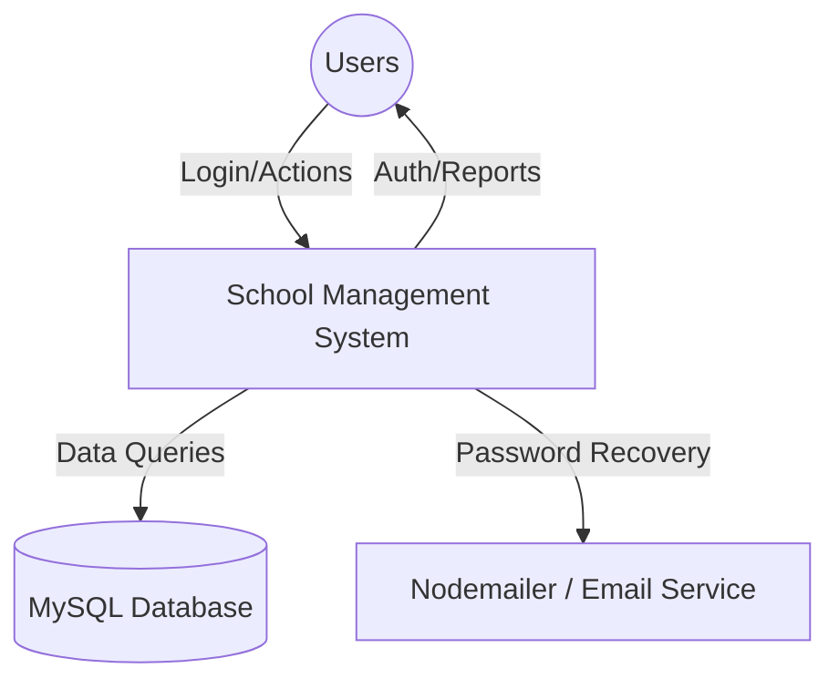
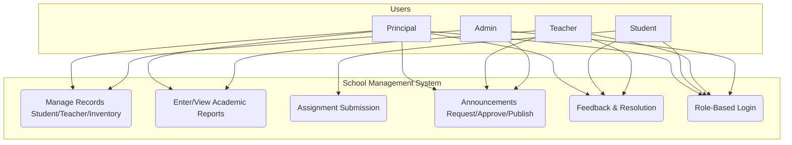
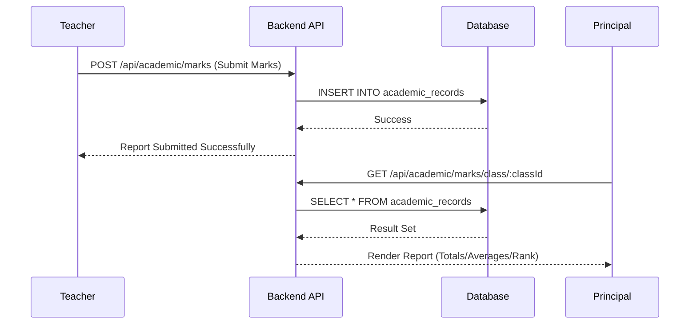
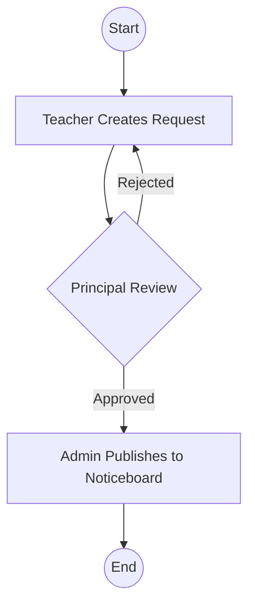
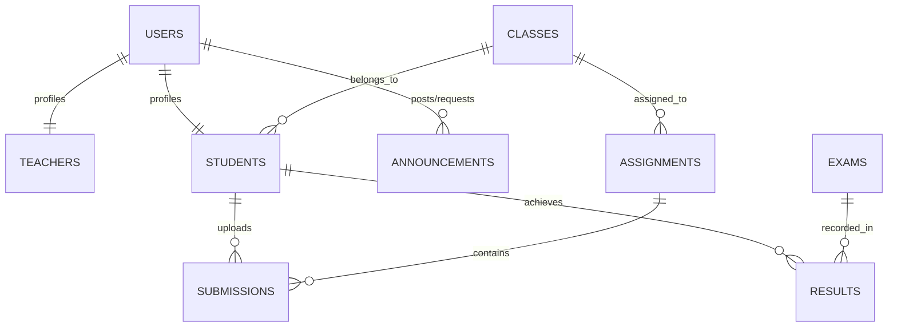

# 📐 System Design & Architecture

This document contains the core design artifacts for the School Management System, as required by the Software Development Project Rubric (Criterion 8).

## 1. Context Diagram
Describes the high-level boundaries of the SMS and its interaction with users.

## 2. Use Case Diagram (Proposed System)
Shows the core functionalities available to each role.

## 3. Sequence Diagram: Report Submission & Review
Illustrates the interaction between a Teacher and the Principal for academic reports.

## 4. Activity Diagram: Announcement Workflow
Shows the approval-driven process for school announcements.

## 5. Normalized Data Model (Entity Relationships)
Simplified view of the normalized database structure.

